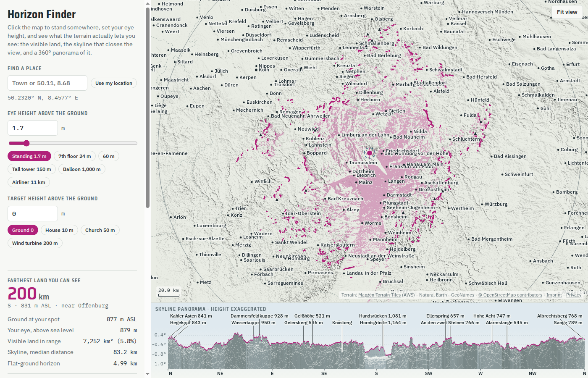

# Horizon Finder

Stand anywhere on Earth (between 85° S and 85° N), set your eye height, and see what the terrain
lets you see: the visible ground on the map, the skyline that closes the view in every direction,
and a 360° panorama of it with named peaks.

**Live:** https://babanin.de/horizon-map/



## What it does

- Click the map (or long-press on a touch screen) to place the observer; search a town or type
  coordinates (`50.11, 8.68`, `50°06'36"N 8°40'48"E`, ...); or use your device location.
- Eye height presets from standing (1.7 m) to an airliner (11 km), an optional target height
  ("can I see a 200 m wind turbine from here?"), view range 50–200 km, and three refraction settings.
- Map: the ground you can see is tinted; hover (or tap) any spot to see whether it is visible
  and, if not, how many metres it sits below your line of sight.
- Panorama: the skyline in every direction with OSM peak names (local or English); hover it (or
  slide a finger along it) to see which ridge forms the skyline and how far away it is.
- Highlight colour: magenta, green, or the colour-blind-safe orange and blue.
- OpenStreetMap overlay on the terrain with an opacity slider (0 % = off, no tile requests).
- The view is stored in the URL, so a link reproduces it.

## How it works

Everything runs in the browser; there is no server-side code.

- Terrain: [AWS Terrain Tiles](https://registry.opendata.aws/terrain-tiles/) (Mapzen Terrarium PNG),
  fetched on demand around the observer: about 100 m per pixel for the far field and about 25 m
  within 5 km.
- A Web Worker (`worker.js`) casts 8,192–16,384 rays along great circles in 60 m steps. A point is
  visible when its elevation angle, corrected for Earth curvature and atmospheric refraction
  (effective radius `R / (1 - k)`), is at least the highest angle seen so far on that ray.
- Known limits: the terrain data smooths summits (Matterhorn reads 4,301 m instead of 4,478 m), and
  it holds no individual buildings or trees, so in a city your real view is narrower than shown.

## Run locally

No build step and no dependencies. The page fetches its data with relative URLs, so serve it over
HTTP (opening `index.html` as a file does not work):

```sh
python3 -m http.server 8765
```

Then open http://localhost:8765. Device location needs HTTPS or `localhost`.

Tests (Node 24, built-in test runner only):

```sh
node --test
```

## Data

| File | Source | Licence | Rebuild |
|---|---|---|---|
| `data/world.json` | [world-atlas](https://github.com/topojson/world-atlas) 2.0.2 (Natural Earth 1:10m) | ISC (Natural Earth: public domain) | `scripts/build_outlines.sh` |
| `data/lakes.json` | [Natural Earth](https://www.naturalearthdata.com/) 1:10m lakes 4.1.0 | public domain | `scripts/build_outlines.sh` |
| `data/cities*.json` | [GeoNames](https://www.geonames.org/) cities1000 | [CC BY 4.0](https://creativecommons.org/licenses/by/4.0/) | `scripts/build_cities.py` |
| `data/peaks/` | [OpenStreetMap](https://www.openstreetmap.org/) `natural=peak` | [ODbL](https://opendatacommons.org/licenses/odbl/), © OpenStreetMap contributors | `scripts/build_peaks.sh` |
| map overlay (fetched at runtime, off by default) | [OpenStreetMap](https://www.openstreetmap.org/) standard tiles | © OpenStreetMap contributors, [tile usage policy](https://operations.osmfoundation.org/policies/tiles/) | – |
| terrain (fetched at runtime) | [Mapzen Terrain Tiles](https://github.com/tilezen/joerd/blob/master/docs/attribution.md) on AWS | see the attribution page | – |

Each script's header has the exact command.

## Licence

The code is MIT licensed, see [LICENSE](LICENSE). The data files keep their own licences (table
above); `data/peaks/` is a database derived from OpenStreetMap and is available under the ODbL.
